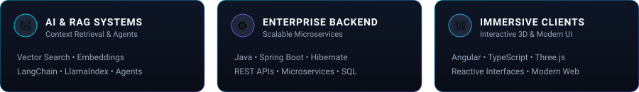
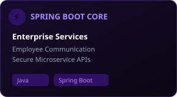
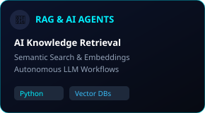
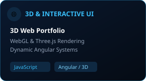
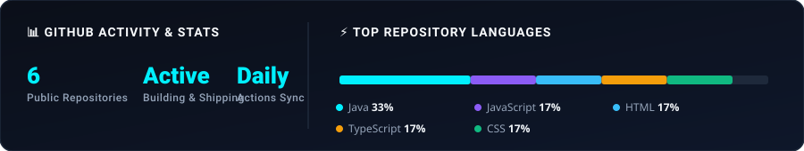
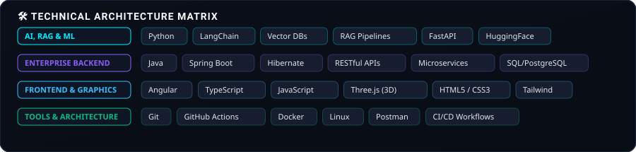

<!-- Hero Banner -->

 

<!-- Core Pillars -->

  

<!-- Featured Spotlight Cards -->
<h3>⚡ FEATURED DOMAINS &amp; ARCHITECTURES</h3>
&nbsp;&nbsp;

  

<!-- Live GitHub Stats & Language Breakdown -->

  

<!-- Technical Architecture Matrix -->

  

<!-- Quick Navigation & Connect -->

  
  &nbsp;
  
  &nbsp;
  

🔄 <i>Automated Profile System: Profile cards and metrics dynamically re-rendered daily via GitHub Actions.</i>

